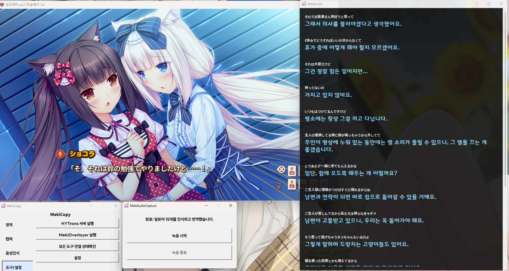

# MekiCopy

화면의 일본어를 OCR로 읽어 복사하거나 한국어 번역을 오버레이로 표시하는 Windows 도구입니다. 시스템 음성의 인식·번역과 영상 파일의 한국어 SRT 생성도 지원합니다.

## 설치

[Releases에서 다운로드](https://github.com/tchinso/MekiCopy/releases)한 ZIP을 압축 해제하고 `Start-MekiCopy.bat`을 실행하세요. `MekiCopy/MekiCopy.exe`를 직접 실행해도 됩니다. Python은 별도로 설치하지 않아도 됩니다.

| 배포판 | 포함 내용 | 처음 사용할 때 |
|---|---|---|
| **Lite** | 모든 앱과 번역 기능 | 필요한 엔진·사전·OCR·번역·음성 모델을 다운로드합니다. MagPie는 필요할 때 설치합니다. |
| **Full** | Lite + hdTrans 엔진·기본 사전, OCR·MT1.5·음성/VAD 모델, MagPie | 포함된 모델을 바로 사용하며 hdTrans는 오프라인 번역이 가능합니다. |

두 배포판의 기능과 실행 파일은 같습니다. TranslatorAPI 언어 모델은 브라우저에서 관리하므로 Full에도 포함되지 않습니다.

- Windows 10 2004 이상, RAM 8GB 이상이 필요하며 16GB 이상을 권장합니다.
- OCR은 CPU로 실행할 수 있으며, 사용 가능한 NVIDIA CUDA 환경에서는 GPU를 사용합니다.
- MT1.5와 TranslatorAPI 번역은 Chrome 또는 Edge가 필요합니다. hdTrans와 클라우드 API 번역에는 브라우저가 필요하지 않습니다.

## 빠른 시작

1. `영역` 탭에서 **임시 영역 선택**을 누르고 텍스트가 있는 곳을 드래그합니다.
2. 위치와 크기를 조절한 뒤 `Enter`로 선택을 마칩니다. `Esc`는 취소입니다.
3. **임시 영역을 확정**을 누릅니다.
4. **인식 후 복사**를 누르고 원하는 곳에 `Ctrl + V`로 붙여넣습니다.

영역이 고정된 화면에서는 마지막 단계만 반복하면 됩니다. 자주 쓰는 영역은 북마크로 저장할 수 있습니다.

## 번역과 실시간 OCR

1. `도구/설정 → 설정 → 번역`에서 번역 서비스를 선택합니다.
2. `번역 오버레이` 설정에서 **오버레이어 번역 모드 사용**을 켜고 저장합니다.
3. `도구/설정`에서 **HYTrans 서버 실행**, **MekiOverlayer 실행**을 누르고 준비될 때까지 기다립니다.
4. 확정 영역을 설정하고 **번역 후 표시**를 누릅니다.

자동으로 반복 인식하려면 **번역 설정 탭 아래쪽**의 **실시간 처리 사용**을 켜고 **최소 인식 간격(초)**을 선택해 저장하세요. 옆의 **?**에 마우스를 올리면 시작 방법을 확인할 수 있습니다.

**실시간 OCR 시작/중지** 버튼은 본체의 **영역** 탭에 있습니다. 다음 조건이 모두 충족되어야 시작할 수 있습니다.

- **오버레이어 번역 모드 사용**이 켜져 있음
- **확정 영역**이 있음
- **HYTrans와 MekiOverlayer**가 실행되어 연결·번역 준비가 완료됨
- **실시간 처리 사용**이 켜져 있음

조건이 해제되면 중지하며, 조건을 다시 갖춘 뒤 시작 버튼으로 재개합니다. 앱을 다시 열어도 자동 시작하지 않습니다.

## 음성과 영상

| 작업 | 시작 방법 |
|---|---|
| 시스템 음성 인식·번역 | `음성인식` 탭에서 HYTrans, MekiScript, MekiAudioCapture를 실행한 뒤 녹음을 시작·종료합니다. |
| 녹음 중 발화별 번역 | MekiAudioCapture에서 **실시간 음성 번역**을 켜고 녹음합니다. 저사양 PC에서는 지연될 수 있습니다. |
| 영상에서 한국어 SRT 생성 | `자막 생성 → MekiSubtitle 열기`에서 영상과 출력 경로를 선택합니다. |

## 문서

- [사용 안내](docs/usage.md): 영역·북마크·분리 버튼·음성·자막·명령줄
- [번역 안내](docs/translation.md): hdTrans·MT1.5·TranslatorAPI·클라우드 API와 실시간 OCR
- [설정과 문제 해결](docs/settings.md): 설정 항목·저장 위치·연결 확인·로그
- [개발 구조](docs/architecture.md): 모듈별 역할·작업 흐름·변경과 검증 기준
- [빌드 안내](BUILDING.md): Lite/Full 빌드·고정 자산·소스와 라이선스
- [검증 기록](VALIDATION.md): 수행한 검사와 확인 범위

소스에서 실행하려면 Python 3.12~3.14와 Tcl/Tk를 설치한 뒤 `install_mekiocr.bat`, `run_mekicopy.bat` 순서로 실행하세요. 고정 의존성은 [requirements-build.txt](requirements-build.txt)에 있습니다.

## 라이선스

MekiCopy의 라이선스 문서는 [LICENSE](LICENSE)입니다. 포함된 엔진·모델·라이브러리에는 각각의 라이선스가 적용됩니다. hdTrans의 AGPL 고지, 대응 소스와 결합 배포 시 확인할 사항은 [빌드 안내의 소스·라이선스](BUILDING.md#소스라이선스)를 참고하세요.
